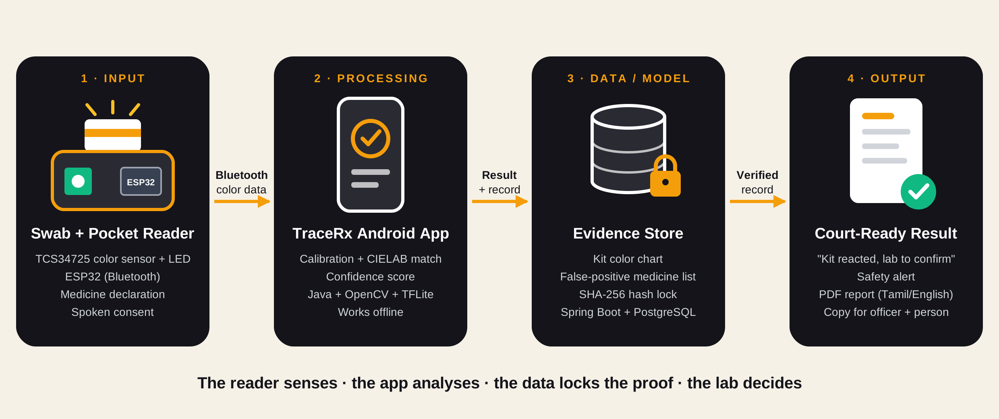

# TraceRx (by Finora)

A digital companion for field drug testing. A pocket reader (ESP32 + color sensor) reads the test kit, a Java Android app analyses the result, and a Spring Boot backend locks every record in a tamper-evident SHA-256 hash chain. The app never says "guilty": it says "Kit reacted. Lab confirmation needed."

Maatram Hackforge 2026-27 · Problem MH26-25 · Theme: HealthTech

## Architecture


## Honest project status

| Part | Folder | Status |
|---|---|---|
| Core logic: CIELAB color match, medicine warnings, SHA-256 hash chain | `backend/.../core` | Written and run: `CoreDemo` output matches expectations |
| REST API (Spring Boot) | `backend/.../api` | Written, not yet run (needs Maven) |
| Reader firmware (ESP32 + TCS34725, Bluetooth LE) | `firmware/esp32_reader` | Written, not yet tested on hardware |
| Android app (Java) | `android/` | Planned, not built yet |
| PostgreSQL storage, PDF report, Tamil UI | - | Planned |

Reference colors and medicine rules in the code are **SAMPLE data**. Replace them with the real kit manufacturer's chart and cross-reactivity list.

## Run the core logic (no framework needed, JDK 17+)
```
cd backend
mkdir out
javac -d out src/main/java/com/finora/tracerx/core/*.java src/main/java/com/finora/tracerx/demo/*.java
java -cp out com.finora.tracerx.demo.CoreDemo
```
Expected: a color match with confidence, a medicine warning, `Chain valid: true`, then `false` after one record is edited.

## Run the API (JDK 17+, Maven)
```
cd backend
mvn spring-boot:run
```
- `POST /api/tests` with `{"officerId":"0417","r":175,"g":90,"b":62,"medicines":["cough syrup"]}`
- `GET /api/chain` and `GET /api/chain/verify`

## Reader firmware
Open `firmware/esp32_reader/esp32_reader.ino` in Arduino IDE, install the Adafruit TCS34725 library, select ESP32 Dev Module, and upload. Wiring is in the file header.

## Limits
A kit result is a screening result only. Every positive needs lab confirmation.
